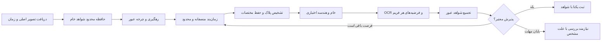

# طرح محصول پلاک‌خوان بر مبنای هر دو ویدیو

تاریخ: ۱۵ اکتبر ۲۰۲۶. وضعیت: پیشنهاد طراحی و برنامهٔ اعتبارسنجی؛ پیاده‌سازی و دستیابی به ۹۹٪ هنوز اثبات نشده‌اند.

## تصمیم اصلی

یک پیش‌پردازش اجباری، یک امتیاز کیفیت و دو رأی مشابه، قرارداد قابل اتکایی برای محصول نیستند. پیشنهاد، یک مسیر محدود و تطبیقی است که شواهد خام را حفظ می‌کند، اصلاح هندسه را اختیاری و مقید به محل پلاک می‌کند، و تصمیم کالیبره‌شده را در سطح عبور خودرو می‌گیرد. مدل‌ها در این معماری قابل ارزیابی و تعویض‌اند؛ توان مدل فعلی در بعضی نمونه‌ها، کفایت آن برای محصول را اثبات نمی‌کند.

## آنچه دو ویدیو واقعاً ثابت می‌کنند

| شاهد | یافته | نتیجهٔ طراحی |
|---|---|---|
| نمونه‌های برچسب‌دار ویدیوی قبلی | در ۷۴ خروجی detector، خام صفر شمارهٔ کامل درست؛ از ۳۸ تصویر آماده‌شده، ۲۱ درست | اصلاح هندسه باید در مسیر باقی بماند؛ این اعداد مربوط به فریم‌های عمدتاً یک خودرو هستند |
| دو خودروی نخست ویدیوی فعلی | خام دو و چهار خوانش درست و یکسان؛ هندسه سپر یا شمارهٔ ناقص را انتخاب کرده | خام باید مستقل از موفقیت هندسه قابل استفاده باشد |
| تاکسی ویدیوی فعلی | حاشیهٔ خودرو در دو فریم تشخیص را بازیابی کرد، اما متن کامل پایدار نشد | مشکل زنجیره‌ایِ کادر، هندسه و OCR؛ حاشیه به‌تنهایی درمان نیست |
| خودروهای نامطمئن ویدیوی قبلی | متن‌های متعارض یا ارقام اضافه با confidence زیاد | confidence و قالب معتبر به‌تنهایی معیار صحت نیستند |
| بازپخش فعلی | ۱۹۹۸ فریم بدون حذف؛ ۶ read، ۳ uncertain، ۲ unread | افت صف علت ضروری این شکست‌ها نیست؛ این نسبت‌ها دقت نیستند |
| بازپخش قبلی | ۲۲۵۵ فریم بدون حذف؛ ۲ read و ۲ uncertain | حتی نتیجهٔ قبلی نیز نزدیک ۹۹٪ تأیید نشده بود |
| آزمایش تابع تصمیم فعلی | دو رأی A، دو رأی B و یک متن خالی، A را read کرد | تساوی و تعارض باید صریحاً مانع پذیرش شوند |

منابع محلی: [جمع‌بندی قبلی](stage_audit_20261014/consolidated_20261015.md)، [رویدادهای قبلی](lossless_video_20261015_complete/events.json)، [تشخیص ویدیوی فعلی](current_video_20261015_diagnosis/README.md)، [آزمایش تساوی رأی](alpr_product_vote_tie_probe_20261015.json).

اشتباه مسیر قبلی، تعمیم سود موضعی هندسه به شرط اجباری تمام تصاویر و استفاده از مجموعهٔ کوچک توسعه برای تصمیم‌های عمومی بود. تغییر آستانه، مدل بزرگ‌تر یا چند فیلتر بیشتر این نقص ارزیابی را جبران نمی‌کند.

## قرارداد قابل اندازه‌گیری ۹۹٪

واحد ارزیابی «عبور مستقل خودرو» است؛ چندصد فریم یک خودرو چندصد نمونهٔ مستقل نیستند.

- هدف اصلی پیشنهادی: حداقل ۹۹٪ همهٔ عبورهای داخل محدودهٔ عملیاتی ازپیش‌تعریف‌شده، شمارهٔ کامل صحیح و منتسب به خودروی صحیح را در مهلت لازم دریافت کنند.
- unread، uncertain، عبور ازدست‌رفته و پاسخ دیرهنگام در این معیار موفقیت نیستند. نرخ بازبینی انسانی جداست و نمی‌تواند موفقیت خودکار را بالا ببرد.
- بودجهٔ پیشنهادی پذیرش شمارهٔ غلط: حداکثر ۰٫۱٪ کل عبورها؛ این عدد پیشنهاد طراحی برای توافق محصول است، نه نتیجهٔ موجود. precision میان پاسخ‌های پذیرفته‌شده نیز جداگانه گزارش شود.
- رویداد تکراری، اتصال پلاک به خودروی اشتباه، جهت اشتباه و اختلال سرویس، شمارنده و معیار پذیرش مستقل داشته باشند؛ یک رویداد اشتباه نباید با چند نتیجهٔ صحیح برای همان خودرو پوشانده شود.
- مهلت پاسخ با سرعت خودرو، فاصلهٔ ناحیهٔ خواندن تا راهبند و سیاست توقف خودرو تعیین شود. p95/p99 تأخیر و سهم نقض مهلت روی سخت‌افزار هدف اندازه‌گیری شوند.

شرایط پشتیبانی‌شده قبل از آزمون مشخص شوند: خانوادهٔ پلاک‌ها، سرعت، زاویه، روشنایی روز/شب، مدت قابل مشاهده بودن، جزئیات واقعی پلاک و کیفیت جریان دوربین. هر مورد دشوار نباید پس از شکست الگوریتم از دامنه خارج شود. در محل نصب تأییدشده، همهٔ عبورها شمرده شوند؛ فراوانی موارد واقعاً خارج از دامنه نیز منتشر شود.

پلاک کاملاً پوشیده یا خارج از تصویر قابل تضمین نیست. محصول باید این وضعیت را تشخیص دهد و مسیر عملیاتی روشن، مثل توقف و بررسی اپراتور یا ابزار شناسایی جایگزین، داشته باشد. این مسیر جایگزین به معنی موفقیت OCR نیست.

## معماری پیشنهادی

### ۱. حفظ شواهد و چرخهٔ عبور

ثبت سبک شواهد باید قبل از detector سنگین انجام شود و حافظهٔ کوتاه‌مدت تصویر اصلی پیش از بازنویسی latest-slot وجود داشته باشد. صرف افزودن بافر بعد از پردازش پلاک کافی نیست. تصاویر منتخب با زمان و مختصات به یک passage متصل شوند؛ در لحظهٔ نمونه‌برداری لازم نیست پلاک قبلاً پیدا شده باشد.

حافظه با سقف بایت و زمان، نه فقط تعداد تصاویر، محدود شود. نمونه‌ها ترکیبی از پوشش زمانی/مکانی، اندازه و بریدگی باشند؛ شارپنس کل خودرو دوباره معیار غالب نشود. کمبود ظرفیت و حذف نمونه ثبت شود. قبل از تشخیص پلاک، هیچ رتبه‌بندی کیفیتی تضمین بهترین فریم را ندارد.

حالت فایل باید فشار برگشتی کامل، ترتیب زمانی و تخلیهٔ EOF داشته باشد. حالت زنده با بودجهٔ محاسبه و انصاف بین دوربین‌ها/خودروها کار کند. حفظ همهٔ فریم‌های RTSP با سخت‌افزار ناکافی وعده داده نشود.

شناسهٔ passage از ID موقت tracker جدا باشد. ادغام ID فقط با شواهد ارتباط انجام شود؛ دو خودروی کنار هم و تغییر صحنه نباید شواهد مشترک پیدا کنند. هر job شامل camera، passage، frame، timestamp و generation باشد. خروج خودرو، پایان jobهای پذیرفته‌شده، مهلت نهایی و قطع دوربین حالت‌های صریح باشند. پاسخ دیررس نباید رویداد بسته‌شده را دوباره بسازد.

خواندن و تصمیم‌گیری می‌تواند پیش از خروج خودرو به حد کافی برسد؛ منتظر ترک تصویر ماندن برای کاربرد راهبند الزاماً مناسب نیست. تأیید زودهنگام فقط با سیاست اعتبارسنجی‌شده انجام شود و اختلاف شواهد بعدی مسیر اصلاح ثبت‌شده داشته باشد.

### ۲. تشخیص پلاک و هندسهٔ مقید

در نسخهٔ اول، detector فعلی با مختصات کامل حفظ شود. خروجی باید شامل کادر پلاک در تصویر اصلی، کادر در context، وضعیت بریدگی، confidence و منشأ detector باشد. کادر خودرو حاشیهٔ محدود داشته باشد؛ حاشیهٔ بزرگ نباید پلاک خودروی کناری را به این خودرو متصل کند.

مسیر بازیابی، جست‌وجوی محدود در ناحیهٔ بزرگ‌تر یا ناحیهٔ خواندن دوربین است. اجرای دوبارهٔ detector برای هر خودرو در هر ۱۰۰ms و روی خودروهای پارک‌شده توجیه نشده است. پس از یافتن پلاک، رهگیری کوتاه پلاک و تشخیص مجدد هنگام افت کیفیت گزینهٔ قابل آزمایش است؛ drift و جابه‌جایی بین خودروها باید سنجیده شود.

هندسه روی پلاک تشخیص‌داده‌شده مقید شود. شمارهٔ راست پلاک و تمام ناحیهٔ نوشته باید حفظ شود؛ کانتور بزرگ داخل context نباید مجوز جایگزینی پلاک باشد. تصویر اصلی تغییرناپذیر بماند و هر تبدیل، ماتریس، ناحیهٔ منبع و علت اعتبار/رد داشته باشد.

برای نسخهٔ بعدی، detector تخصصی پلاک با چهارگوشه/landmark یا segmentation دقیق، نامزد مناسبی برای جایگزینی هندسهٔ عمومی است. این انتخاب به دادهٔ چهارگوشه، انواع پلاک و ارزیابی نیاز دارد؛ وجود چهار خروجی گوشه به معنی صحیح بودن آن‌ها نیست.

### ۳. خواندن تطبیقی با بودجهٔ مشخص

هر نمونه خام همیشه قابل بررسی بماند. خام و نسخهٔ اصلاح‌شده، دو فرضیه از یک frame هستند. هندسهٔ ناموفق نباید تصویر خام را از OCR حذف کند. نسخهٔ اصلاح‌شده فقط پس از اعتبارسنجی مکانی/بریدگی وارد مجموعه شود.

یک cascade محدود اجرا شود: ابتدا مسیر کم‌هزینه؛ در صورت نبود شاهد کافی یا تعارض، مسیر جایگزین معتبر روی چند نمونهٔ متنوع؛ سپس در صورت سود اثبات‌شده، OCR دوم یا detector جایگزین. سقف محاسبه و زمان برای هر passage و کل دوربین مشخص باشد. همهٔ فیلترها و مدل‌ها روی همهٔ تصاویر اجرا نشوند.

OCR دوم باید با خطاهای مکمل روی مجموعهٔ توسعه انتخاب شود؛ مدل کاراکتری یا مدل توالی قوی‌تر فقط نامزد آزمایش‌اند. دو مدل ممکن است همان خطا را تکرار کنند. اجرای آن‌ها روی همان فریم دو شاهد تصویری مستقل تولید نمی‌کند.

قالب پلاک برای اعتبارسنجی و محدودسازی فرضیه‌ها استفاده شود؛ ارقام گمشده نباید برای ساخت شمارهٔ ظاهراً معتبر حذف یا حدس زده شوند. خانواده‌های پشتیبانی‌شده، مانند شخصی و تاکسی، تعریف و ارزیابی مستقل داشته باشند. قالب ناشناخته به‌زور به قالب رایج تبدیل نشود.

### ۴. تصمیم در سطح عبور

اصل مهم: «دو رأی مشابه» معادل «اطمینان ۹۹٪» نیست. ابتدا خروجی‌های یک فریم به فرضیهٔ واحد یا تعارض درون‌فریم تبدیل شوند؛ سپس بین فریم‌های متفاوت تجمیع شوند. فاصلهٔ زمانی نیز استقلال آماری خطاها را تضمین نمی‌کند.

ویژگی‌های تصمیم شامل توافق شمارهٔ کامل، تعارض با رقیب، کیفیت و اندازهٔ پلاک، ابهام کاراکترها، تنوع نمونه‌ها، بریدگی و اطمینان اتصال به خودرو باشد. در تساوی، اختلاف مهم یا ضعف مشاهده، وضعیت باز بماند یا نیازمند بررسی شود. تعداد رأی و فاصلهٔ برنده با رقیب از دادهٔ اعتبارسنجی تعیین شوند؛ اعداد جدید صرفاً با دیدن پاسخ این دو ویدیو تنظیم نشوند.

confidence فعلی میانگین امتیاز کاراکترهای انتخاب‌شده است. باید از احتمال صحت کامل رویداد تفکیک شود. کالیبراسیون روی دادهٔ جداگانه و برای کل cascade نهایی انجام شود؛ انتخاب بیشترین confidence از چند نسخه رفتار توزیع امتیاز را تغییر می‌دهد. حتی کالیبراسیون نیز تضمین انتقال به دوربین جدید نیست.

### ۵. ثبت و مشاهده‌پذیری محصول

برای هر عبور: وضعیت، علت تصمیم، شماره یا فرضیه‌ها، شواهد تصویری منتخب، نسخهٔ مدل/تنظیمات، زمان‌ها و شمارنده‌های مراحل ذخیره شوند. علت‌ها حداقل شامل missed_detection، cropped_plate، invalid_geometry، invalid_text، conflicting_reads، insufficient_evidence و deadline_exceeded باشند.

ثبت رویداد با کلید یکتای passage تکرارپذیر و idempotent باشد؛ retry نباید چند ورود یا خروج بسازد. interface ثبت از تشخیص مستقل باشد تا replay همان تصمیم را بدون دسترسی به دیتابیس اجرا کند. در rollout اولیه، خروجی جدید در حالت سایه با ثبت فعلی مقایسه شود.

## ساختار پیشنهادی در همین کد

| Module | Interface کوچک پیشنهادی | مسئولیت و seam آزمون |
|---|---|---|
| PassageEvidence | observe(frame, tracks, crossings)، tick(time)، close(camera, reason) | نگهداری شواهد، lifecycle، شناسهٔ عبور، کارهای معوق و بودجه |
| PlateRecognizer | recognize(samples, budget) | detector و adapterهای OCR تزریق‌شده؛ خروجی فرضیه‌ها با frame_id و provenance |
| PassageDecision | evaluate(evidence, deadline_state) | قواعد تعارض، کالیبراسیون و نتیجهٔ قابل بازپخش؛ بدون نوشتن دیتابیس |
| Event persistence | save(decision) | ثبت یکتا، retry و تاریخچهٔ اصلاحات |

این‌ها در ابتدا در همین برنامه و فرایند قابل پیاده‌سازی‌اند؛ نیازی به چند سرویس شبکه‌ای نیست. `PlateCandidates` به تدریج به نگهدارندهٔ شواهد تبدیل شود، `plate_ocr.py` تصمیم ثبت را از اجرای مدل جدا کند، و `plate_geometry.py` تبدیل همراه مختصات برگرداند. adapter فقط در seamهایی اضافه شود که واقعاً مدل یا ورودی متفاوت دارند. مدل و clock و sink تزریق شوند تا تست همان interface اجرای واقعی را پوشش دهد.

## ارزیابی و شرط انتشار

۱. هر دو ویدیوی فعلی به مجموعهٔ regression/development تبدیل شوند. شمارهٔ مرجع مستقلِ عبورها، محدودهٔ خودرو/پلاک، عبورهای ازدست‌رفته و موارد واقعاً غیرقابل مشاهده برچسب بخورند. خروجی خود OCR برچسب مرجع نیست.

۲. مجموعهٔ جدید از جریان اصلی دوربین‌ها در روز/شب، ورود/خروج، سایه/نور شدید، خودروهای کنار هم و خانواده‌های مختلف پلاک جمع‌آوری شود. آموزش، تنظیم، کالیبراسیون و آزمون نهایی به تفکیک دوربین، جلسه/روز و هویت خودرو جدا شوند. فریم‌های یک عبور یا تکرار همان خودرو بین بخش‌ها پخش نشوند.

۳. آزمایش حذف/افزودن هر تغییر روی مجموعهٔ یکسان انجام شود: baseline، حفظ خام، هندسهٔ مقید، تصمیم جدید، حاشیهٔ کادر و مدل جایگزین. اثر هر تغییر بر خوانش کامل، پذیرش غلط، latency و بار پردازش گزارش شود. بالاتر رفتن confidence یا read-count معیار کافی نیست.

۴. نسخه و thresholdها قبل از آزمون نهایی freeze شوند. معیار کلی، معیار هر شرایط مهم و بازهٔ اطمینان گزارش شود. اگر پس از دیدن شکست آزمون تنظیم انجام شد، آن مجموعه دیگر آزمون نهایی دست‌نخورده نیست.

۵. شاهد آماری حداقلی: ۲۹۹ موفقیت از ۲۹۹ عبور مستقل و نماینده، بدون هیچ شکست، کران پایین یک‌طرفهٔ ۹۵٪ را کمی بالاتر از ۹۹٪ می‌برد. این عدد برای تمام دوربین‌ها و تمام زیرگروه‌ها تضمین نیست. برای کران بالای ۰٫۱٪ پذیرش غلط با صفر خطای مشاهده‌شده، حدود ۲۹۹۵ عبور مستقل لازم است. در عمل پوشش شرایط و وجود خطا به دادهٔ بیشتری نیاز دارد.

۶. تست بار روی سخت‌افزار و تعداد دوربین هدف لازم است. بازپخش فعلی ۶۶٫۵ ثانیه ویدیو حدود ۷۶۷ ثانیه پردازش داشت؛ حدود ۵۷۷ ثانیه در observation بود. این معیار FPS مستقیم RTSP نیست، اما اضافه‌کردن OCR و fallback بدون بودجهٔ پردازش قابل دفاع نیست. اگر پس از زمان‌بندی و کاهش inference ظرفیت کافی نبود، سخت‌افزار شتاب‌دهنده بخشی از راهکار محصول است.

۷. نصب هر دوربین، آزمون پذیرش تصویربرداری داشته باشد: عرض واقعی پلاک، زاویه، motion blur، فوکوس، نور و فرصت مشاهده. اعداد پیکسلی راهنماهای یک سازنده، آستانهٔ جهانی مدل ایرانی ما نیستند. سلامت کیفیت تصویر، میزان خطا/نامطمئن و نمونه‌ای از پاسخ‌های پذیرفته‌شده پس از انتشار پایش شود تا خطاهای خاموش دیده شوند.

## ترتیب اجرایی پیشنهادی

| مرحله | خروجی | شرط عبور |
|---|---|---|
| A: معیار و داده | manifest برچسب‌ها، replay مشترک، گزارش علت و آزمون تساوی | قابلیت بازتولید هر دو دستهٔ شکست و معیار ثابت |
| B: اصلاح مسیر شواهد و تصمیم | حفظ خام، variant بر اساس frame، هندسهٔ مقید، رد تعارض | بازیابی دو خودروی فعلی و حفظ نمونه‌های صحیح قبلی، بدون افزایش پذیرش غلط در regression |
| C: ظرفیت و lifecycle | جداسازی sampling از detector، بودجه، تخلیهٔ EOF/قطع، ثبت یکتا | نبود گم‌شدن خاموش شواهد/رویداد و عبور از تست بار |
| D: ارتقای مدل بر اساس خطا | detector چهارگوشه یا OCR جدید/تنظیم‌شده روی دادهٔ واقعی | بهبود هم‌زمان معیارهای ازپیش‌تعیین‌شده روی دوربین‌های ندیده |
| E: اعتبارسنجی محصول | آزمون نهایی مستقل، shadow rollout، پذیرش نصب | رسیدن به هدف ۹۹٪ و بودجهٔ خطا/تأخیر با شواهد آماری |

مرحلهٔ B اصلاح مهندسی لازم است؛ به‌تنهایی ادعای ۹۹٪ ایجاد نمی‌کند. اگر معیارهای D/E حاصل نشد، باید مدل، داده یا تصویربرداری اصلاح شود. توقف روی مدل فعلی به این دلیل که دو نمونه را درست خوانده، تصمیم محصولی نیست.

## پشتوانهٔ بیرونی و حدود استنتاج

- [راهنمای تصویربرداری Axis](https://whitepapers.axis.com/en-us/license-plate-capture): اهمیت اندازهٔ واقعی پلاک، زاویه، نور و شاتر؛ معیار مختص مدل ما را باید اندازه گرفت.
- [Guo و همکاران، ICML 2017](https://proceedings.mlr.press/v70/guo17a.html): امتیاز مدل الزاماً کالیبره نیست؛ تعمیم به تصمیم ALPR پیشنهاد طراحی ماست.
- [Ovadia و همکاران، NeurIPS 2019](https://proceedings.neurips.cc/paper_files/paper/2019/hash/8558cb408c1d76621371888657d2eb1d-Abstract.html): اطمینان و کالیبراسیون تحت تغییر توزیع می‌توانند افت کنند.
- [SelectiveNet، ICML 2019](https://proceedings.mlr.press/v97/geifman19a.html): تفکیک پوشش و خطای پاسخ‌های پذیرفته‌شده؛ استفاده از خود این مدل الزام نیست.
- [NIST، بازهٔ دقیق دوجمله‌ای](https://itl.nist.gov/div898/software/dataplot/refman2/auxillar/exacbino.htm): مبنای محاسبهٔ شاهد آماری؛ فرض استقلال و نمایندگی باید رعایت شود.

[یادداشت منابع اولیه](alpr_product_reliability_sources_20261015.md) ادعاهای منابع را از استنتاج‌های مهندسی جدا می‌کند. هیچ‌کدام، این پیاده‌سازی یا تضمین ۹۹٪ در همهٔ شرایط را تأیید نکرده‌اند.