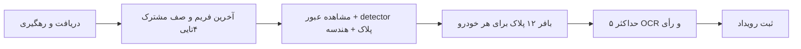

# جمع‌بندی آزمایش‌ها و راهکارهای پلاک‌خوان پارکینگ — ۱۵ اکتبر ۲۰۲۶

مهم‌ترین نتیجه: در این ویدیو هم ورودی تصویر و هندسه مشکل دارند، هم فرصت‌های مناسب ممکن است پیش از بافر پلاک حذف شوند. بیشترین بهبود اندازه‌گیری‌شدهٔ اولیه از اصلاح هندسه/برش نوار متن بود؛ آزمایش تازه، جبران ناهمگنی روشنایی را به‌عنوان گزینهٔ کم‌هزینهٔ امیدوارکننده نشان داد. تغییر مدل بزرگ‌تر و تغییر runtime هنوز سود نشان نداده‌اند. درصد سهم هر علت در تمام عبورها قابل‌محاسبه نیست.

این گزارش نتایج تاریخی و وضعیت فعلی را جدا می‌کند. گزارش‌های قدیمی گاهی از سقف سه OCR، فاصلهٔ ۲۵۰ms و بسته‌شدن در لحظهٔ عبور حرف می‌زنند؛ این‌ها توصیف نسخهٔ فعلی نیستند. تمام آزمایش‌های این نوبت آفلاین بودند؛ کد محصول، مدل‌ها، JSON دوربین و دیتابیس تغییر نکردند.

## تنظیمات واقعاً فعال

مرجع: [cameras.json](../../src/reno/data/cameras.json).

| مورد | مقدار فعلی | اثر عملی |
|---|---|---|
| دوربین | cam2، نوع video | آزمایش روی فایل، نه جریان اصلی RTSP |
| منبع | InShot_20261012_210725035.mp4 | کلیپ تدوین‌شده؛ پرش زمانی و فشرده‌سازی آن نمایندهٔ قطعی دوربین خام نیست |
| مدل خودرو | src/models/vehicle/yolo26n_openvino_model | ورودی فعلی tracker برابر ۳۸۴×۶۴۰ است؛ خطای قبلی ناسازگاری ورودی با export به ROI مربوط نبود |
| detection_interval | ۳ | تشخیص دوره‌ای خودرو؛ به‌معنای سه OCR یا بافر سه‌تایی نیست |
| ROI و خط | چندضلعی نرمال‌شده، خط سه‌نقطه‌ای، entry_exit و inside_point | محدودهٔ مشاهده و جهت عبور را تعیین می‌کنند؛ کراپ OCR از تصویر اصلی است |
| plate_sampling | شیء خالی | مقادیر پیش‌فرض کد استفاده می‌شوند، نه مقادیر صریح JSON |
| پیش‌فرض نمونه‌ها | interval=۰٫۱s، near=۰٫۰۹s، capacity=۱۲ | نمونه‌گیری اسمی؛ سرعت واقعی به پردازش و حذف فریم وابسته است |
| پایان شواهد | exit_delay=۰٫۷۵s، stale=۵s | پس از عبور، تا ناپدیدشدن خودرو و مهلت مربوطه شواهد جمع می‌شود |
| اتصال دوبارهٔ ID | reid_gap=۰٫۵s و reid_iou=۰٫۳۵ | اتصال محدود مکانی/زمانی؛ تضمین هویت در ازدحام نیست |
| OCR | حداکثر پنج تصویر؛ حداقل دو متن معتبر یکسان با confidence≥۰٫۸ | تساوی دو شماره و اشتباه تکرارشونده همچنان مسئله‌اند |

ROI چند رأس تکراری دارد؛ از این مشاهده به‌تنهایی نمی‌توان خرابی را نتیجه گرفت. کوچک‌کردن ROI اطلاعات تازه‌ای برای نوشته ایجاد نمی‌کند؛ حذف بخش نزدیک‌تر مسیر حتی می‌تواند فرصت خواندن را کم کند. جابه‌جایی خط نیز جای اصلاح ثبت شواهد را نمی‌گیرد.

## فهرست آزمایش‌ها و نتیجهٔ قابل‌دفاع

| آزمایش | شاهد | نتیجه و محدودیت |
|---|---|---|
| ویدیوی قدیمی ۶۸۰×۴۲۰، فریم‌های ۲۰۰۰–۲۰۶۰ | ۶۰ مورد از ۶۱ کراپ به متن نرسید؛ تنها خروجی متن روی چراغ بود | مشکل قبل از OCR هم وجود داشت؛ شارپنس کل خودرو معیار مناسبی نبود. این فایل با ویدیوی فعلی فرق دارد. [گزارش](../plate_debug_2000_2060/README.md) |
| نمونهٔ ۱۰۸۰p، فریم ۵۱۰ | برش مستطیلی: غلط؛ چهارگوشهٔ دستی: شمارهٔ مرجع 58م87245 با همان OCR | توان OCR در ورودی مناسب ثابت شد؛ موفقیت دستی به معنی موفقیت خودکار نیست. [گزارش](../plate_debug_1080/README.md) |
| کوچک‌سازی همان پلاک اصلاح‌شده | عرض ۱۲۰، ۱۰۰ و ۸۰ صحیح؛ ۶۰ یک رقم غلط با امتیاز ۰٫۸۴۶؛ ۴۰ غلط/ناقص | جزئیات واقعاً مهم‌اند؛ آستانهٔ جهانی برای پلاک ایرانی استخراج نشده. [داده](manual.json) |
| هندسهٔ خودکار روی ۱۴۶ کراپ یک خودرو | ۷۴ خروجی detector؛ OCR خام صفر صحیح؛ ۳۸ آماده‌شده و ۲۱ صحیح | اصلاح چرخش و نوار متن بزرگ‌ترین بهبود اولیه بود؛ ۷۴/۱۴۶ نرخ recall نیست چون کادر مرجع همهٔ فریم‌ها نداریم. [داده](summary.json) |
| نسخهٔ قدیمی‌تر همین آزمایش | ۳۷ خروجی هندسه و ۲۰ صحیح | با عدد ۳۸/۲۱ تناقض ندارد؛ نسخه/حاشیهٔ برش عوض شده است. برای مقایسهٔ جاری از ۳۸/۲۱ استفاده می‌کنیم. [گزارش](../exit_plate_trial/README.md) |
| مدل پلاک روی چرخ | فریم ۱۵۹: کادر ۹۷×۹۸، confidence=۰٫۴۴۳؛ هندسه رد کرد | امتیاز detector تضمین وجود پلاک نیست. [داده](detector_current.json) |
| افزایش سقف OCR و کاهش فاصله | در بازپخش کنترل‌شده، سه تصویر با near=۲۵۰ms نامطمئن؛ با پنج تصویر شمارهٔ درست دو رأی گرفت؛ near=۹۰ms نمونهٔ درست دیگری را حفظ کرد | اثر محلی مثبت؛ این مقایسه از detector ذخیره‌شده استفاده کرد و سنجش افت فریم زنده نیست. [گزارش](../uncertain_20261014/README.md) |
| رتبه‌بندی فقط با شارپنس | کاربر افت دقت دید؛ رتبه‌بندی ذخیره‌شده فریم‌های غلط ۳۷۲ و ۳۶۹ را اول می‌گذارد | برگشت داده شد. همان top5 در این نمونه هنوز دو رأی صحیح داشت؛ افت کلی را نمی‌توان از این یک replay کمی‌سازی کرد. [داده](selection.json) |
| چرخهٔ رویداد خودروی آخر | نسخهٔ قدیم در ۲۱۰۷ بدون کاندید می‌بست؛ پلاک در ۲۱۴۲ قابل‌خواندن شد و ID عوض شده بود | نگه‌داشتن رویداد و اتصال ID باعث حفظ یک خوانش شد؛ نتیجه از بدون ورودی به uncertain رسید، نه خوانش تأییدشده. این اصلاح در کد فعلی وجود دارد. [گزارش](../last_car_20261012/diagnosis.md) |
| برچسب نامطمئن | رویداد ۹۸ یک خوانش با امتیاز زیاد؛ رویداد ۹۶ چند متن متناقض | پایین‌آوردن آستانه مشکل کمبود شواهد یا اختلاف متن را حل نمی‌کند. رأی تکراری غلط هم سابقه دارد. [گزارش](../uncertain_20261014/README.md) |
| پیش‌پردازش سازندهٔ OCR | ۲۶/۳۸ صحیح؛ شش بازیابی و یک از دست‌رفته در قیاس با ۲۱ | بهبود مجموع، همراه پسرفت موضعی؛ نسخهٔ خام همچنان صفر صحیح. [داده](publisher_summary.json) |
| JPEG رویدادهای دیگر | برخی متن‌ها پس از فیلتر عوض شدند و برخی ثابت ماندند | مرجع مستقل ندارند؛ افزایش confidence یا تغییر متن را بهبود نمی‌نامیم. [داده](other_events_preprocessing.json) |
| YOLOv8m جایگزین | در یک کراپ از فایل دیگر، هیچ‌کدام پلاک پیدا نکردند؛ تک‌اجرای سرد تقریباً ۰٫۹۲ در برابر ۷٫۳۲s | سود دقت ثابت نشد؛ مدل بزرگ‌تر اولویت اول نیست. [گزارش](../plate_model_trial/README.md) |
| ONNX Runtime در برابر OpenVINO، FP32 | روی دو کادر، OpenVINO سریع‌تر نبود | تغییر runtime به‌تنهایی راهکار اثبات‌شدهٔ این CPU نیست. [داده](runtime.json) |
| batch پنج OCR | متن‌ها یکسان؛ میانه ۱۴۰۴ به ۱۲۵۸ms در سه تکرار | حدود ۱۰٪ کاهش زمان این مرحله؛ نه ۱۰٪ افزایش سرعت کل pipeline. [داده](batch_timing.json) |
| fallback مدل فعلی | فریم ۳۰۰ بدون اجرای fallback تشخیص داشت؛ فریم ۱ هر دو مدل بی‌نتیجه | مسیر اجرایی تأیید شد، بهبود recall هنوز اندازه‌گیری نشده. هزینهٔ اضافی می‌تواند افت صف را بیشتر کند. [داده](fallback_smoke.json) |
| چهارگوشهٔ خودکار جدید | آزمون مصنوعی موفق؛ صفر پذیرش در ۷۴ کادر واقعی؛ آماده‌سازی قبلی بدون تغییر | محافظه‌کار است ولی برای این داده هنوز سود ندارد. میانه بررسی حدود ۱٫۳۷ms. [گزارش](fallback_corners_20261015.md) |
| بررسی کد جدید | ۲۶ آزمون fallback، هندسه، بافر و حفظ عبور گذشت | صحت شاخه‌ها با افزایش دقت میدانی متفاوت است. |

بازپخش قدیمی دیگری روی فایل ۱۸۰فریمی دو خروجی توافقی ساخت، اما شماره‌ها مرجع مستقل نداشتند؛ از آن نرخ دقت استخراج نشده است. برخی اجراهای سنگین/بازپخش‌های تاریخی با کد ۱۴۳ متوقف شدند؛ برای بخش ناتمام نتیجه اعلام نمی‌کنیم. [سوابق پیاده‌سازی](../plate_pipeline_implementation.md) و [گزارش مرحله‌ای](README.md).

## آزمایش تازهٔ فیلترها

در این نوبت، هندسه و همان ۳۸ تصویر ثابت نگه داشته شدند. شش مسیر از پیش مشخص، بدون جست‌وجوی پارامتر روی جواب صحیح، با OCR واقعی مقایسه شدند. معیار، برابری کل متن با 58م87245 است. این‌ها ۳۸ فریم هم‌بسته از یک خودرو و دادهٔ توسعه‌اند؛ نه ۳۸ خودروی مستقل و نه نرخ دقت عملیاتی.

| روش | صحیح از ۳۸ | بازیابی نسبت به پایه | خراب‌شدن صحیح قبلی |
|---|---:|---:|---:|
| هندسهٔ فعلی، بدون فیلتر تازه | 21 | 0 | 0 |
| CLAHE ملایم | 25 | 4 | 0 |
| شارپ‌سازی ملایم | 22 | 1 | 0 |
| جبران ناهمگنی روشنایی | 29 | 8 | 0 |
| bilateral + CLAHE | 17 | 1 | 5 |
| دودویی‌سازی Otsu | 12 | 3 | 12 |
| پیش‌پردازش سازنده، آزمایش قبلی | ۲۶ | ۶ | ۱ |

جبران روشنایی در این آزمایش یعنی تخمین زمینهٔ روشنایی با Gaussian با sigma=۷، سپس تقسیم شدت تصویر بر آن و مقیاس‌کردن به ۱۸۰؛ فرمول اجرایی `clip(gray / (background + 1) * 180, 0, 255)` است. هدف کم‌کردن اثر سایه/روشنایی تدریجی است. این الگوریتم جزئیات تازه خلق نمی‌کند، blur یا رقم بریده را هم ترمیم نمی‌کند. پارامترها فقط یک انتخاب آزمایشی‌اند؛ این روش را «اختراع جدید» یا راهکار قطعی نمی‌نامیم.

در مقایسهٔ پنج فریم ثابتِ انتخاب‌شدهٔ فعلی، پایه دو رأی صحیح داشت؛ CLAHE و جبران روشنایی سه رأی صحیح داشتند. با این حال تصمیم نهایی هر سه از ابتدا صحیح بود؛ بنابراین این آزمایش افزایش تعداد خودروهای درست‌خوانده‌شده را ثابت نمی‌کند. در مقابل bilateral+CLAHE دو رأی برای شمارهٔ غلط ساخت و طبق قاعدهٔ فعلی آن را read کرد؛ شاهد روشنی است که فیلتر ظاهراً مفید می‌تواند تصمیم نهایی را بدتر کند.

داده‌ها: [نتایج تک‌فریم](filter_trial_20261015.json)، [خلاصه و رأی پنج تصویر](filter_summary_20261015.json)، [اسکریپت بازتولید](filter_trial_20261015.py). میانهٔ اجرای مجموعهٔ شش آماده‌سازی روی یک تصویر کوچک حدود ۱٫۵۳ms بود؛ این عدد شامل OCR نیست و زمان جداگانهٔ هر فیلتر محسوب نمی‌شود. افزودن نسخهٔ دوم OCR از خود فیلتر بسیار پرهزینه‌تر است.

## گلوگاه معماری و تغییر پیشنهادی

بافر ۱۲تایی بهترین نمونه‌های **پردازش‌شده** را نگه می‌دارد. صف چهار‌تایی قدیمی‌ترین را بدون سنجش کیفیت حذف می‌کند؛ جایگاه latest-frame هم می‌تواند فریم میانی را بازنویسی کند. در نتیجه قبل از بافر نیز افت داریم. detector و هندسه داخل worker مشاهده اجرا می‌شوند و رسیدگی به عبور/بافر را معطل می‌کنند. اختلاف سرعت روی CPU فعلی مهم است: در سنجش قدیمی detector حدود ۱٫۶–۱٫۷s و OCR حدود ۲۷۳ms میانه داشتند؛ بار و تعداد تکرارها متفاوت است و نباید از این اعداد FPS دقیق استخراج کرد.

معماری پیشنهادی:

1. **حالت ارزیابی فایل بدون حذف:** فشار برگشتی از مصرف‌کننده تا decoder، حذف‌نکردن در latest-slot و صف، پردازش به ترتیب timestamp، تخلیهٔ کارهای باقی‌مانده در EOF. کندترشدن قابل‌قبول است؛ نتیجه قابل‌بازتولید می‌شود. فقط بزرگ‌کردن صف چهار‌تایی این هدف را برآورده نمی‌کند. timeout فعلی پنج‌ثانیه‌ای shutdown نیز باید برای detector کند و تخلیهٔ کامل بررسی شود.
2. **مسیر زنده با مشاهدهٔ سبک:** عبور، پیوند ID و نگهداری سریع کراپ خودرو از detector سنگین جدا شوند. برای هر خودرو مخزن محدودِ نمونهٔ خام با تنوع زمانی و کنترل بریدگی داشته باشیم؛ detector از آن کار بردارد. این مخزن با بافر ۱۲ پلاک موجود متفاوت است. قبل از پیدا شدن پلاک نمی‌توان کیفیت نوشته را دقیق امتیاز داد؛ بنابراین نباید دوباره فقط شارپنس خودرو را برنده کنیم.
3. **پس از اولین تشخیص، رهگیری کوتاه خود پلاک:** چند کراپ بعدی با کادر رهگیری‌شده برداشته شوند؛ detector دوره‌ای یا هنگام افت کیفیت/تغییر شکل دوباره اجرا شود. این راه تعداد inference را کم می‌کند، اما drift باید اندازه‌گیری و رد شود. افزودن چند thread به CPU چهارهسته‌ای معادل افزایش throughput نیست.
4. **کارهای معوق و پایان رویداد:** هر کار برچسب دوربین، شناسهٔ passage، frame و timestamp داشته باشد؛ بعد از ادغام IDها، خروجی به همان passage برسد. بستن رویداد باید پایان کارهای پذیرفته‌شده را هم لحاظ کند. بودجهٔ حافظه/زمان و انصاف میان خودروها تعیین شود تا یک خودرو بقیه را گرسنه نگذارد.
5. **اندازه‌گیری در هر مرحله:** تعداد دریافت، جایگزینی latest، حذف صف، نمونه‌های بررسی‌شده، شکست detector اصلی/fallback، رد هندسه، جایگزینی near، OCR، مدت‌ها و علت uncertain ثبت شود. بدون این شمارنده‌ها سهم افت صف در یک رویداد تاریخی معلوم نیست.

این طرح احتمال حفظ فرصت مناسب را بهتر می‌کند؛ افزایش دقت آن هنوز benchmark نشده و حتی مخزن خام هم تضمین بهترین فریم کل عبور نیست. ظرفیت‌ها باید با بودجهٔ حافظه و زمان حضور خودرو تعیین شوند، نه عددسازی.

## ترتیب راهکارهای پیشنهادی

| اولویت | کار | پشتوانه و معیار پذیرش |
|---|---|---|
| ۱ | ارزیابی فایل بدون افت + شمارنده‌های مراحل + شمارهٔ مرجع خودروهای متعدد | پیش‌نیاز مقایسهٔ معتبر؛ خروجی ثابت، تمام رویدادها تخلیه‌شده و شمارش افت مشخص |
| ۲ | حفظ هندسهٔ فعلی و آزمون جبران روشنایی در کنار پایه | بهترین سود تازهٔ محلی: ۲۱ به ۲۹؛ روی عبورهای جدید باید بدون افزایش پذیرش غلط تکرار شود |
| ۳ | جداکردن نمونه‌برداری سریع از detector و رهگیری کوتاه پلاک | گلوگاه موجود در کد روشن است؛ کاهش inference و افزایش نمونهٔ قابل‌خواندن در هر عبور باید سنجیده شود |
| ۴ | بهبود ثبت تصویر برای دوربین واقعی | جریان اصلی مستقیم، زوم اپتیکی روی محدودهٔ عبور، فوکوس، نور و شاتر؛ تغییر تنظیمات دوربین روی فایل InShot اثر گذشته‌نگر ندارد |
| ۵ | اصلاح تصمیم در تعارض | برندهٔ یکتا، رد تساوی و تنوع زمانی؛ نسخه‌های فیلترشدهٔ یک فریم رأی مستقل نباشند. ممکن است uncertain بیشتر شود ولی پذیرش غلط کمتر شود |
| ۶ | batch OCR و بودجهٔ fallback | سود batch محدود ولی اندازه‌گیری‌شده؛ سود detector fallback در چند خودرو هنوز باید سنجیده شود |
| بعدی | مدل چهارگوشهٔ آموزش‌دیده/تنظیم اختصاصی detector | اگر مشکل هندسه و محل پلاک روی دادهٔ برچسب‌دار باقی ماند؛ صرف قوی‌تر/بزرگ‌ترشدن مدل کافی نیست |

برای آزمون دو مسیر اصل/فیلتر، پنج فراخوانی فعلی را خودکار به ده تبدیل نکنیم. اگر بودجهٔ اضافی لازم شد، صریح و محدود باشد. بیشترین confidence به‌تنهایی برای انتخاب متن درست کافی نیست؛ رأی‌ها باید به فریم منبع وصل باشند. پارامترهای CLAHE و سایر فیلترها نباید با دیدن جواب صحیح هر خودرو انتخاب شوند.

## ایده‌های تکمیلی و منابع

- **هم‌ترازی ۲–۳ کراپ و ادغام مقاوم:** ایدهٔ آزمایشی بعدی، پس از حفظ فریم‌ها؛ رد جفت‌های ناهم‌تراز لازم است تا نوشته دوگانه نشود. هنوز روی دادهٔ ما اجرا نشده است. [مرجع ECC در OpenCV](https://docs.opencv.org/4.x/dc/d6b/group__video__track.html) و [مقالهٔ اصلی Deep Burst SR](https://openaccess.thecvf.com/content/CVPR2021/html/Bhat_Deep_Burst_Super-Resolution_CVPR_2021_paper.html). مقالهٔ یادگیری burst شاهد سرعت یا دقت همین طرح ساده روی ویدیوی فشردهٔ ما نیست.
- **CLAHE و فیلترها:** قابلیت‌های پردازش تصویر هستند، نه تضمین OCR؛ نتیجهٔ محلی bilateral و Otsu در جدول بالا دلیل رد پیش‌فرض‌کردن آن‌هاست. [OpenCV CLAHE](https://docs.opencv.org/4.x/d5/daf/tutorial_py_histogram_equalization.html)، [OpenCV filtering](https://docs.opencv.org/4.x/d4/d13/tutorial_py_filtering.html).
- **SR مولد و deblur سنگین:** فعلاً اولویت پایین؛ هم هزینه روی CPU اندازه‌گیری نشده، هم ظاهر خواناتر تضمین وفاداری عدد نیست. استنباط کاربردی از [مقالهٔ Perception–Distortion Tradeoff](https://arxiv.org/abs/1711.06077)، نه حکم شکست همهٔ SRها.
- **دوربین تخصصی:** راهنمای Axis اهمیت میدان دید، نور IR، شاتر و زاویه را توضیح می‌دهد؛ حدود ۱۰۰–۱۵۰ پیکسل برای بسیاری از نرم‌افزارها روی پلاک اروپایی و زاویهٔ مجموع کمتر از ۳۰ درجه توصیه می‌کند، نه آستانهٔ مدل ایرانی ما. [منبع](https://whitepapers.axis.com/en-us/license-plate-capture).

[یادداشت پژوهش منابع اولیه](filter_research_20261015.md) جزئیات بیشتری دارد.

## معیار موفقیت نهایی

روی عبورهای مستقلِ چند خودرو با نور و جهت مختلف، چهار خروجی را جدا گزارش کنیم: شمارهٔ کامل صحیح، شمارهٔ غلط پذیرفته‌شده، uncertain و unread. معیار سرعت: زمان هر مرحله، تأخیر رویداد، تعداد inference و افت فریم. مجموعهٔ آزمون را از فریم‌های مورد استفاده برای انتخاب پارامترها جدا نگه داریم. نتیجهٔ مطلوب کم‌شدن خطای عملیاتی است؛ تبدیل برچسب نامطمئن به شمارهٔ غلط بهبود نیست.
